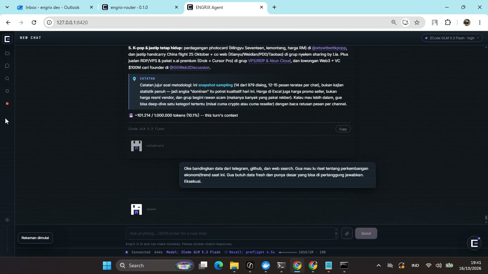
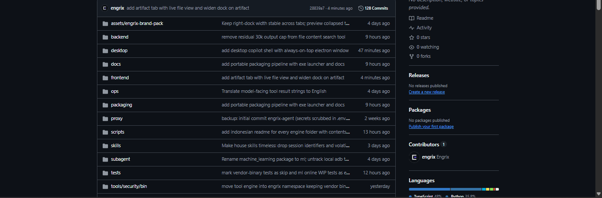

# Engrix Agent — Architecture Portfolio

**Engrix Agent** is a self-hosted, single-owner AI engineering agent that plans, executes, and verifies real work on a real machine: an explicitly registered tool surface behind a drawer system, layered memory that survives context compression, sub-agents judged by mechanical evidence rather than their own reports, and four UI surfaces — from a full workspace to an always-on-top desktop copilot.

## See it run

An unedited screen recording of one real task (research across three source types → synthesis → terminal execution → Excel deliverable), captured by the agent's own screen-recorder:

▶ **[Watch the demo video](https://engrix.github.io/engrix-agent-docs/)** — 8m34s, no audio, 1× speed. Recorded by pressing the in-app record button; that button is itself one of the agent's tools.

## What it looks like

One frontend build, four surfaces — the full workspace, a 380px floating panel, and a one-button bubble in the browser; the same build inside an always-on-top Electron window:

| Full workspace | Copilot panel | Bubble |
|---|---|---|
|  |  |  |

The engine's repository at the same moment — the portfolio documents this system; the code itself stays private (a deliberate choice, explained under Safety):

## What you are looking at

- **[System overview](en/architecture/overview.md)** — why the engine is one process, and why its folders are separated by a one-way dependency contract
- **[The flow of one turn](en/architecture/flow.md)** — the actual path a message takes, hop by hop, with the real module and function names
- **[The tool system](en/architecture/tool-system.md)** — how one agent drives a large tool surface coherently (catalog → drawer → full schema, loaded once)
- **[Layered memory](en/architecture/memory.md)** — how compression keeps the core of a task instead of the noise
- **[Sub-agents](en/architecture/subagents.md)** — thirteen division contracts, and why a child is judged by its evidence counters instead of its summary
- **[Interfaces](en/architecture/interfaces.md)** — four UI surfaces from one build, and everything the agent can reach
- **[Design decisions](en/decisions/001-one-process-architecture.md)** — 9 ADRs, each opened by the question that forced it
- **[Roadmap](en/roadmap.md)** — shipped, partial, and not-yet, stated as-is

## How the numbers on these pages stay true

Every measured claim here is checked by `scripts/verify_docs_claims.py`, which reads the live engine source, measures the fact, and **fails the build** when a document disagrees with the code. It does not compare a document to another document — it compares a document to the registry, the file tree, and the route table.

That is a deliberate design choice, and it exists because the opposite happened: an earlier version of this checker printed `ALL CLAIMS MATCH` while the engine had moved on, because it asserted that a document *contained a particular tool count* rather than asserting that the count was still the right one. A gate that cannot fail is decoration. This one is tested by mutating a document and watching it go red.

## Safety and access

The tool inventory is deliberately broad (browsers, terminals, desktop control, remote servers, security-research pipelines), and that breadth is exactly why access is narrow by design.\n\n**The bind address is an enforced invariant, not a convention.** `WEB_HOST` must stay loopback (`127.0.0.1`, `localhost`, or `::1`); the server refuses to start on any other address, because the REST and WebSocket surfaces have no auth layer and the approve endpoint executes irreversible actions. That check lives in the config class and raises at startup, so a misconfiguration cannot run silently.\n\n**Write actions are staged as reviewable diffs.** Repository mutations, message sends, and destructive device operations build pending-approval entries with a diff preview, and a pull request is created without merging — merging needs a separate approval.\n\n**Auto-approve is on by default, and that is a deliberate owner decision.** `ENGRIX_AUTO_APPROVE` defaults to `1`, which executes staged proposals right after the tool succeeds so the model sees the result in the same turn instead of waiting in a UI queue. This is a single-owner system where the owner is also the operator; the tradeoff is stated here rather than hidden, and setting the variable to `0` restores the manual queue. Two guards stay active even with auto-approve on: the two-step confirmation for permanent browser-profile destruction, and the planning gate.

Sub-agents get a narrower surface than the parent, not a copy of it: each of the thirteen divisions declares its own tool pool, and read-only divisions are fenced per tool at the host rather than by instruction in a prompt.

The code stays private not because there is something to hide but because it contains the details of a running personal system; the architecture, the decisions, and the recorded evidence of it working are what this repository publishes.

## Origin

This project did not start as an architecture exercise. It started with three questions:

> *"How do I make my work easier? How do I work more efficiently? How do I cut my workload by ~80%?"*

The answer became an assistant that can do everything, run anywhere, and never lose the thread of what it is doing — even after hours of continuous work inside one task.

## Status

Running in daily production on the owner's machine. What is shipped, what is partial, and what is still on the drawing board is stated honestly in the [roadmap](en/roadmap.md) — nothing on this page is aspirational.

## Documentation

Two languages, same content:

| Section | English | Indonesian |
|---|---|---|
| System overview, flow, tool system, memory, sub-agents, interfaces | [en/architecture/](en/architecture/overview.md) | [id/architecture/](id/architecture/overview.md) |
| Design decisions (ADR, problem → solution) | [en/decisions/](en/decisions/001-one-process-architecture.md) | [id/decisions/](id/decisions/001-one-process-architecture.md) |
| Roadmap & honest status | [en/roadmap.md](en/roadmap.md) | [id/roadmap.md](id/roadmap.md) |

Start here if you only read one page: **[the flow of one turn](en/architecture/flow.md)** — what actually happens between a sentence and a tool call. Then **[the tool system](en/architecture/tool-system.md)** — how an agent drives hundreds of tools without drowning in them.
