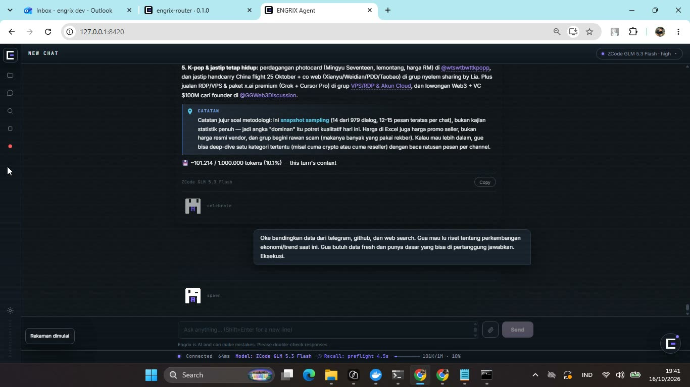
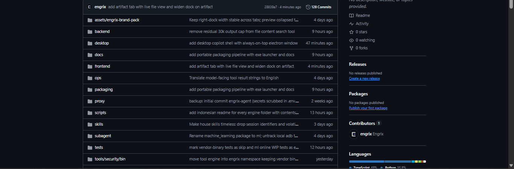

# Engrix Agent — Architecture Portfolio

**Engrix Agent** is a self-hosted, single-owner AI engineering agent that plans, executes, and verifies real work on a real machine: 459 registered tools across 23 categories, layered memory that survives context compression, and four UI surfaces — from a full workspace to an always-on-top desktop copilot.

## See it run

An unedited screen recording of one real task (research across three source types → synthesis → terminal execution → Excel deliverable), captured by the agent's own screen-recorder:

▶ **[Watch the demo video](https://engrix.github.io/engrix-agent-docs/)** — 8m34s, no audio, 1× speed. Recorded by pressing the in-app record button; that button is itself one of the agent's tools. (All numbers on these pages were captured by a live registry-parity checker run on **2026-10-21** against commit `9b906dae`.)

## What it looks like

One frontend build, four surfaces — the full workspace, a 380px floating panel, and a one-button bubble in the browser; the same build inside an always-on-top Electron window:

| Full workspace | Copilot panel | Bubble |
|---|---|---|
|  |  |  |

The engine's repository at the same moment — the portfolio documents this system; the code itself stays private (a deliberate choice, explained under Safety):

## What you are looking at

- **[System overview](en/architecture/overview.md)** — why the engine is one process, and why its folders are separated by a one-way dependency contract
- **[The tool system](en/architecture/tool-system.md)** — how one agent drives 459 tools coherently (catalog → drawer → full schema, loaded once)
- **[Layered memory](en/architecture/memory.md)** — how compression keeps the core of a task instead of the noise
- **[Interfaces](en/architecture/interfaces.md)** — four UI surfaces from one build, and everything the agent can reach
- **[Design decisions](en/decisions/001-one-process-architecture.md)** — 8 ADRs, each opened by the question that forced it
- **[Roadmap](en/roadmap.md)** — shipped, partial, and not-yet, stated as-is

## Safety and access

The tool inventory is deliberately broad (browsers, terminals, desktop control, remote servers, security-research pipelines), and that breadth is exactly why access is narrow by design. The engine runs as a single-owner instance, not a public service: nothing listens beyond localhost, and the owner's account is the only one that exists. Actions that cannot be undone — repository mutations, message sends, destructive device operations — pass through an explicit approval step before they execute, and every tool call is recorded with its result in the session ledger. The code stays private not because there is something to hide but because it contains the details of a running personal system; the architecture, the decisions, and the recorded evidence of it working are what this repository publishes.

## Origin

This project did not start as an architecture exercise. It started with three questions:

> *"How do I make my work easier? How do I work more efficiently? How do I cut my workload by ~80%?"*

The answer became an assistant that can do everything, run anywhere, and never lose the thread of what it is doing — even after hours of continuous work inside one task.

## Status

Running in daily production on the owner's machine. What is shipped, what is partial, and what is still on the drawing board is stated honestly in the [roadmap](en/roadmap.md) — nothing on this page is aspirational.

## Documentation

Two languages, same content:

| Section | English | Indonesian |
|---|---|---|
| System overview, tool system, memory, interfaces | [en/architecture/](en/architecture/overview.md) | [id/architecture/](id/architecture/overview.md) |
| Design decisions (ADR, problem → solution) | [en/decisions/](en/decisions/001-one-process-architecture.md) | [id/decisions/](id/decisions/001-one-process-architecture.md) |
| Roadmap & honest status | [en/roadmap.md](en/roadmap.md) | [id/roadmap.md](id/roadmap.md) |

Start here if you only read one page: **[the tool system](en/architecture/tool-system.md)** — how an agent drives hundreds of tools without drowning in them.
