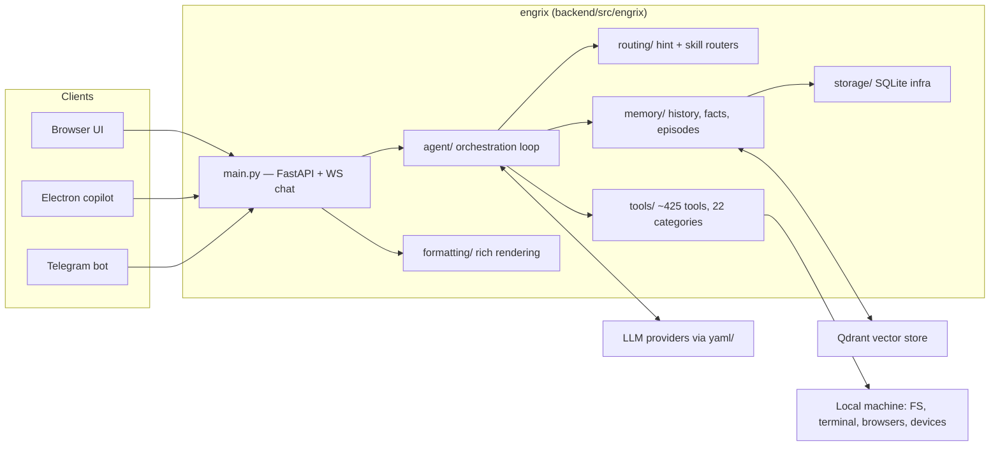

# System Architecture

Engrix Agent is a local-first engineering agent: one FastAPI backend process, one
React frontend served by that process, and an Electron shell that reuses the same
frontend for an always-on-top desktop copilot.

## Top-level view



## Request lifecycle (one chat turn)

1. **Ingest** — a message arrives over WebSocket (UI/Electron) or the Telegram poller.
   `main.py` normalizes it into a session-scoped request.
2. **Context assembly** — the agent loop pulls conversation history, verified facts, the
   current task position, and semantic recall (Qdrant) through the `memory/` layer,
   then renders the system prompt from `personality/`.
3. **Model call** — provider + model are resolved from the model registry, which is
   loaded from `yaml/` at boot (one YAML file per provider). Streaming tokens are
   forwarded to the client as they arrive.
4. **Tool execution** — when the model emits a tool call, the loop validates it against
   the tool registry, resolves the category router, executes, and feeds the observation
   back. Risky tools go through an approval flow surfaced in the UI.
5. **Persist** — history, facts, and episode summaries are written via `memory/`;
   artifacts land in `exports/`; the final answer is rendered through `formatting/`.

## Package layering (one-way imports)

```
config → storage → memory → routing → formatting
                       ↓            ↓
                    curation      tools
                       ↓            ↓
                    learning      agent → bootstrap → main
```

Rules enforced across the codebase:

- `agent/`, `tools/`, and the API layer may import from `memory/` — never from
  `storage/` directly.
- `memory/` may import `storage/`; the reverse is forbidden (infrastructure knows
  nothing about the domain).
- Circular import between sibling packages is broken by demoting the shared piece to a
  lower layer (e.g. `routing/` was extracted precisely to break an agent↔tools cycle).

## Frontend architecture

- **React + TypeScript (Vite)**, served as static files by FastAPI — one process, one
  port, no CORS story.
- State lives in small domain stores (`chatStore`, `workspaceStore`, `uiModeStore`,
  `themeStore`) — no global framework.
- **Four UI modes from one build**: `full` (complete workbench), `panel` (floating
  copilot inside the page), `bubble` (collapsed launcher), `desktop` (Electron shell
  loading the same bundle with `?ui=desktop`). Same chat surface, different container.
- A right dock hosts three tabs — **Workspace** (file tree + canvas), **Artifact**
  (live final content of files the agent just wrote, auto-refreshed on file-change
  events), **Review** (diffs of proposed edits).

## Desktop copilot (Electron)

Frameless 400×640 window, `alwaysOnTop('floating')`, shown without stealing focus,
with content protection enabled (excluded from screen capture), tray icon + global
Alt+M hotkey. It never duplicates the engine: if the backend is already running, the
shell simply connects; auto-spawn is opt-in via a flag and guarded by a health check.

## Data & runtime layout

- **SQLite** (WAL mode) — conversation history, facts, task metrics, verification
  ledger, episodes. Single-user, embedded: the right engine for a local agent, and a
  clean seam for a future Postgres driver on the server deployment.
- **Qdrant** — semantic recall over knowledge chunks; runs either embedded or as a
  server (Docker), selected by environment config.
- **Sandbox isolation** — an `ENGRIX_SANDBOX=1` flag boots a second instance on a
  different port with a separate `.sandbox` database and gated side effects
  (Telegram, background loops). This is how features are verified against the real
  engine without ever touching the production instance.
