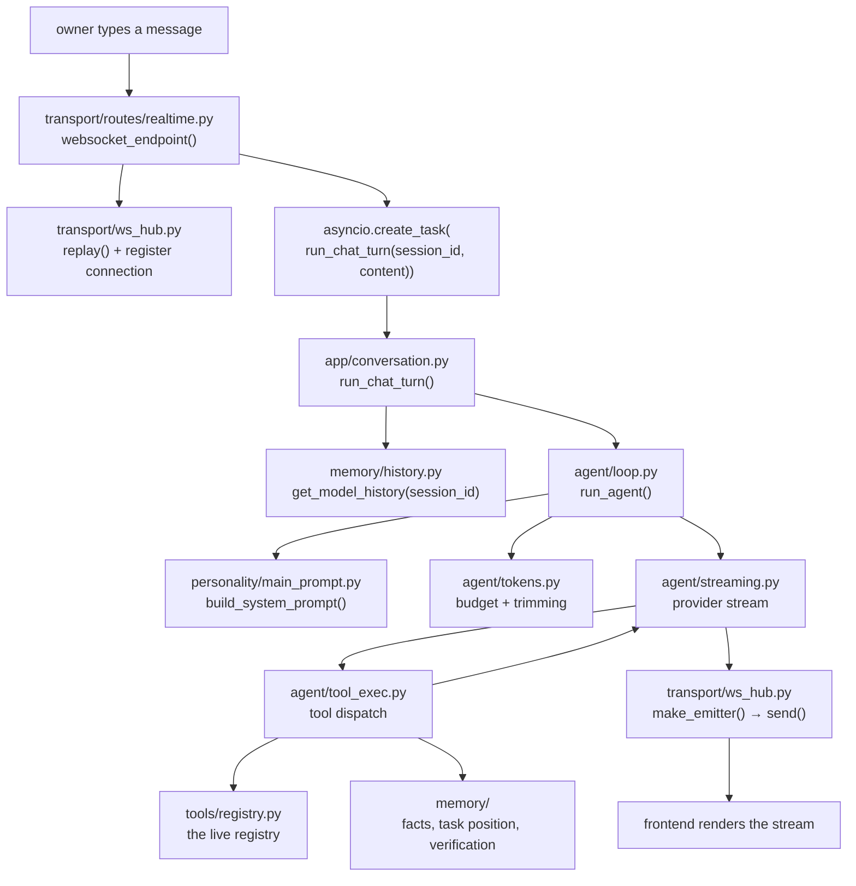

# The Flow of One Turn

## The question

> *When the owner types a sentence, what actually happens — in order, and in which files?*

Architecture diagrams usually show boxes. This page shows the path a single message takes, with the real module and function names, so any claim here can be checked by opening the file. Nothing on this page is inferred from intent; every hop names a symbol that exists in the engine.

## The whole path

## Hop by hop

**1. The socket opens once.** `transport/routes/realtime.py` exposes a single WebSocket route, `websocket_endpoint()`. On connect it calls `ws_hub.replay()` — the hub keeps a buffer of what already streamed, so a reconnecting browser does not lose the middle of an answer. Then it registers the socket under the session id.

**2. A turn is a task, not a request handler.** Incoming content becomes `asyncio.create_task(run_chat_turn(session_id, content))`. That single line is the whole concurrency model: the socket stays free to receive stop signals and approval clicks while the turn runs, and `ws_hub._tasks[session_id]` holds the handle so a second message cannot silently start a parallel turn in the same room.

**3. `app/conversation.py` decides what kind of turn this is.** `run_chat_turn()` loads history via `db.get_model_history(session_id)`, handles attachments and pending files, and calls `run_agent()`. A document upload takes the sibling path `run_document_turn()` — same loop, different entry context. This module is the boundary between "what the transport received" and "what the agent is being asked to do".

**4. `agent/loop.py` runs the iteration loop.** `run_agent()` is the orchestrator: it assembles the prompt, calls the provider, streams tokens, executes whatever tools the model asked for, and feeds results back — up to `AGENT_MAX_ITERATIONS`. It is one function by design, because the loop's state transitions are the thing being tested; splitting it across files was tried and made the failure modes harder to see.

**5. The prompt is assembled, never concatenated.** `personality/main_prompt.py::build_system_prompt()` builds the base rules and attaches only the tool manuals for categories that are currently open. `agent/tokens.py` then applies the budget: a soft cap (`_CONTEXT_TOKEN_SOFT_CAP`, 128000) and an adaptive ceiling at 60% of the model's context window, whichever is smaller.

**6. Streaming is a separate concern from deciding.** `agent/streaming.py` owns provider differences — retry races, connect-fail cooldowns, payload-size-aware timeouts, reasoning-trace pruning — while `_compute_current_tools_and_prompt()` decides what the model is allowed to see on this iteration given the open drawers.

**7. Tool execution is where memory gets written.** `agent/tool_exec.py` dispatches the call, records the entry in history, and — this is the part that matters — writes the side effects that later turns depend on: `memory/verification.py` records what was verified, `memory/task_position.py` records decisions and the active question, `memory/fact.py` extracts facts mechanically.

**8. Everything the model says reaches the UI through one emitter.** `ws_hub.make_emitter()` produces the per-session sender; `send()` fans out to every socket registered for that session. This is why a turn started in the desktop window and a browser tab watching the same session show identical text.

## Where a turn can fail, and what catches it

| Failure | What happens |
|---|---|
| Provider stream dies mid-answer | `streaming.py` retries under a cooldown; the hub's replay buffer keeps the partial text so the UI does not go blank |
| The model loops on the same tool | The iteration cap ends the turn; the partial answer is finalized by `_finalize_answer_text()` rather than discarded |
| A tool raises | The error is captured into the tool result and fed back to the model, which can correct course in the next iteration |
| The owner sends a second message mid-turn | `ws_hub._tasks` already holds a running task for that session, so the second one is refused instead of racing |
| Context grows past the budget | `tokens.py` trims mechanically; long tool outputs are compacted at read time by `memory/history.py`, never rewritten in the database |

## Why this page exists

A portfolio can describe an architecture. This page is the part that is checkable: every arrow above names a real function, and `scripts/verify_docs_claims.py` asserts that the modules it names still exist. If the engine moves, this page fails the gate instead of quietly becoming fiction.

Next: [Layered Memory](memory.md) — what survives all of this.
