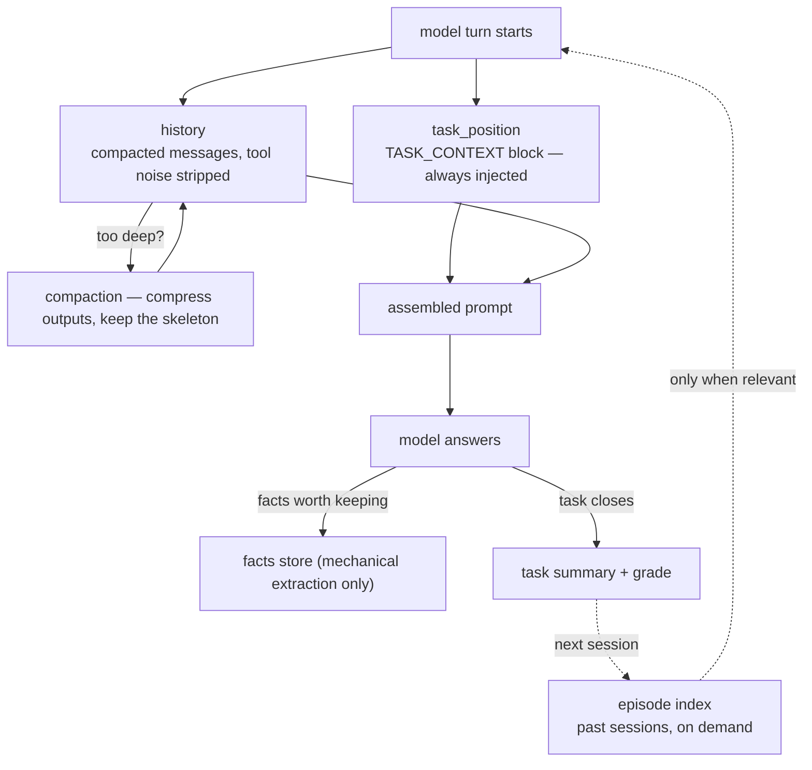

# Layered Memory

## The origin problem

The very first question behind this project:

> *"How can the agent never forget context — even inside one long task room, even across tasks?"*

Naive chat history has two failure modes: it bloats until the model loses the beginning in the middle, or it gets truncated and the agent literally forgets what it is doing. Both are unacceptable for an agent that runs hours-long engineering sessions.

## The solution: compress, but keep the core

Memory is a domain layer (`memory/`) with specialized stores, each solving one kind of forgetting:

| Store | Role |
|---|---|
| **Facts (Layer 1)** | Persistently extracted session facts — mechanical extraction only, no model-written facts, with a stopword filter against confabulated entries |
| **History** | Message history with tool-block sanitization and **compaction built in** — long tool outputs are compressed, not the meaning |
| **Task position** | A `TASK_CONTEXT` block injected at every model turn: what task is active, what step it is on, what was decided — the agent always knows what it is doing |
| **Task summaries** | Per-task grade and summary; a room's history grows *smaller*, not bigger, as work progresses |
| **Episode index** | Cross-session digests formatted for the prompt — past experiences are available on demand, not dumped by default |
| **Cross-room topics** | Pointers only — the index lists what other conversations covered; content is retrieved on demand from the vector store |

How the pieces feed one turn of the loop:

The design principle: **the deeper the chat, the more it compresses — but the core stays.** An agent in hour four of a session still has the task's skeleton in front of it every single turn.

## Ranking and relevance

Retrieval returns candidates; it does not decide what the model actually sees. A rerank layer reorders retrieved chunks by query relevance (a reranking service over the candidates, with configurable candidate/keep counts and empirically calibrated score thresholds that decide between a confident hit, a weak hit worth flagging, and a clean miss). Weak hits are labelled as weak instead of being presented as solid answers — the agent knows when the evidence is thin.

A small online-learning layer (`ml/`) keeps models that hold learnable state (per-session preference baselines, route selection). It is deliberately modest: its goal is to reduce information gaps — which tools actually get used, which routes prove stable — not to make the agent "smarter".

## What the agent sees each turn

The injected context is not folklore; it is inspectable. Each model turn receives, among other things: a structured task-context block (active task, current step, decisions so far), the compacted message history, and — on demand — digests of past sessions plus pointers to what other rooms covered. Because the assembly is explicit, anything in it can be audited: the agent can quote the exact blocks it received, and a reader can verify each claim against what was actually injected.

## Storage underneath

The infrastructure layer (`storage/`) holds a single SQLite connection (WAL mode, foreign keys, busy timeout, guarded write-lock cursor) with schema versioning and migrations. Domain code never touches raw SQL wiring — one layer owns the mechanics, one owns the meaning. Concurrency is solved by staying single-writer: WAL lets readers proceed while one write lock is held, and the deployment rule is one engine process per database — parallel instances share a server-mode Qdrant, never the same SQLite file. Semantic recall rides a separate vector store (Qdrant) that can run embedded for a single instance or in server mode for parallel instances.

Next: [Interfaces](interfaces.md) — four ways to talk to the same engine.
