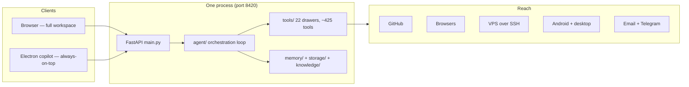

# System Overview

## The critical question

> *What happens when an agent like this runs for eight hours straight — does it hold together, or does every piece eventually need babysitting?*

That question drove every decision on this page. A one-off demo script is easy; a system that still makes correct choices at hour eight — with a compressed context, dozens of opened tool drawers, and three side quests from earlier in the session — is an architecture problem.

Engrix Agent is a local-first engineering agent: one FastAPI backend process, one React frontend served by that process, and an optional Electron shell that reuses the same frontend as an always-on-top desktop copilot. It runs on Windows — the deployment target is the owner's machine — and every hard number on these pages (tool counts, registry parity) was captured by a live checker run on 2026-10-16 against repo commit `b1a7a71`.

## Why the folders are separated

The engine is a Python package (`engrix/`) with a strict one-way layering. Each folder answers one question, and higher layers may depend on lower ones — never the reverse:

```
engrix/
├── config.py        configuration & paths (depends on nothing)
├── storage/         INFRASTRUCTURE: SQLite connections, schema, migrations
├── memory/          DOMAIN: what the agent "knows" (history, facts, tasks)
├── knowledge/       semantic retrieval (vector store)
├── formatting/      output rendering
├── curation/        knowledge curation pipeline
├── routing/         category drawer state & routing hints
├── personality/     persona & prompt assembly
├── tools/           ~425 executable capabilities
├── ml/              online learning & ranking
├── agent/           the orchestration loop (planning, execution, verification)
├── bootstrap/       wiring: connects everything at startup
├── main.py          FastAPI entry point
frontend/            React workspace UI (served by the backend)
desktop/             Electron shell (reuses the same frontend build)
```

The separation is not aesthetics — it is the maintenance contract:

- **`agent/` may call `memory/`, never `storage/` directly.** Storage details cannot leak into orchestration logic.
- **`memory/` owns the domain, `storage/` owns the mechanics.** Swapping a storage engine means touching one layer, not twenty call sites.
- **`bootstrap/` is the only place that knows how pieces connect.** Every other module can be imported and tested in isolation.

## One process, many surfaces

The backend serves the built frontend itself, so a deployment is one process, one port, one version:



The browser gets the full workspace; the Electron copilot loads the identical build with a query flag (`?ui=desktop`), so all UI modes share one codebase and one dist.

## Stack

| Layer | Choice |
|---|---|
| Backend | Python 3.12, FastAPI, WebSocket chat streaming |
| Frontend | React + TypeScript + Vite |
| Desktop | Electron (frameless, always-on-top copilot window) |
| Storage | SQLite (WAL) + Qdrant (local embedded or server mode) |
| Packaging | Portable pack: source + venv + frontend build, single `engrix.exe` launcher |

## Alternatives considered

- **Microservices** (backend split into services) — rejected: the agent needs shared in-process state (registry, drawer state, memory) and single-machine deployment; splitting buys distributed-systems problems no one here has.
- **PostgreSQL first** — rejected for now: a single writer with embedded SQLite in WAL mode covers the load; the storage layer isolates the swap decision (see [dual storage](../decisions/005-dual-storage.md)).
- **Vector-only memory** — rejected: semantic recall cannot reproduce exact facts; mechanical extraction and vector search solve different modes of forgetting, so both stay.

Next: [Tool System](tool-system.md) — the part that makes an agent able to drive hundreds of tools coherently.
