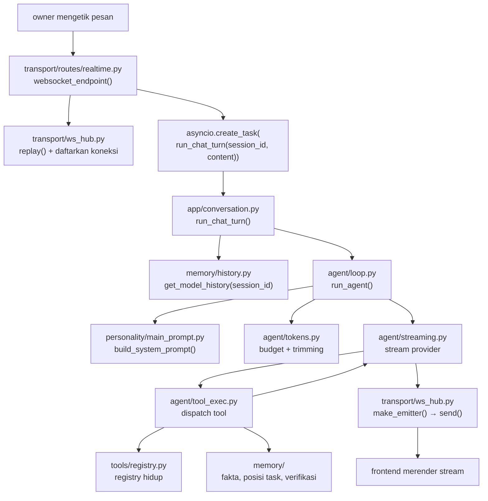

# Alur Satu Turn

## Pertanyaannya

> *Waktu owner mengetik satu kalimat, sebenarnya apa yang terjadi — dalam urutan apa, dan di file mana?*

Diagram arsitektur biasanya menampilkan kotak. Halaman ini menampilkan jalur yang ditempuh satu pesan, dengan nama modul dan fungsi yang nyata, jadi setiap klaim di sini bisa dicek dengan membuka filenya. Tidak ada yang disimpulkan dari niat; setiap lompatan menyebut simbol yang memang ada di engine.

## Jalur lengkapnya

## Lompatan demi lompatan

**1. Socket dibuka sekali.** `transport/routes/realtime.py` mengekspos satu route WebSocket, `websocket_endpoint()`. Saat connect ia memanggil `ws_hub.replay()` — hub menyimpan buffer dari apa yang sudah di-stream, jadi browser yang reconnect tidak kehilangan bagian tengah jawaban. Lalu socket didaftarkan di bawah id sesi.

**2. Satu turn adalah task, bukan request handler.** Konten masuk menjadi `asyncio.create_task(run_chat_turn(session_id, content))`. Satu baris itu adalah seluruh model konkurensinya: socket tetap bebas menerima sinyal stop dan klik approval selagi turn berjalan, dan `ws_hub._tasks[session_id]` menyimpan handle-nya sehingga pesan kedua tidak bisa diam-diam memulai turn paralel di room yang sama.

**3. `app/conversation.py` memutuskan ini turn jenis apa.** `run_chat_turn()` memuat history lewat `db.get_model_history(session_id)`, menangani lampiran dan file pending, lalu memanggil `run_agent()`. Upload dokumen mengambil jalur saudaranya, `run_document_turn()` — loop sama, konteks masuk berbeda. Modul ini adalah batas antara "apa yang diterima transport" dan "apa yang diminta ke agent".

**4. `agent/loop.py` menjalankan loop iterasi.** `run_agent()` adalah orkestratornya: merakit prompt, memanggil provider, men-stream token, mengeksekusi tool apa pun yang diminta model, dan mengembalikan hasilnya — sampai `AGENT_MAX_ITERATIONS`. Bentuknya satu fungsi dengan sengaja, karena transisi state loop itulah yang sedang diuji; memecahnya ke beberapa file pernah dicoba dan justru membuat mode kegagalannya lebih sulit dilihat.

**5. Prompt dirakit, tidak pernah disambung-sambung.** `personality/main_prompt.py::build_system_prompt()` membangun aturan dasar dan hanya melampirkan manual tool untuk kategori yang sedang terbuka. `agent/tokens.py` lalu menerapkan budget: soft cap (`_CONTEXT_TOKEN_SOFT_CAP`, 128000) dan plafon adaptif di 60% context window model, mana yang lebih kecil.

**6. Streaming adalah urusan terpisah dari memutuskan.** `agent/streaming.py` memiliki perbedaan antar-provider — race retry, cooldown gagal-connect, timeout sadar ukuran payload, pemangkasan jejak reasoning — sementara `_compute_current_tools_and_prompt()` memutuskan apa yang boleh dilihat model pada iterasi ini berdasarkan laci yang terbuka.

**7. Eksekusi tool adalah tempat memory ditulis.** `agent/tool_exec.py` men-dispatch panggilan, mencatat entri di history, dan — ini bagian yang penting — menulis efek samping yang dipakai turn berikutnya: `memory/verification.py` mencatat apa yang diverifikasi, `memory/task_position.py` mencatat keputusan dan pertanyaan aktif, `memory/fact.py` mengekstrak fakta secara mekanis.

**8. Semua yang dikatakan model sampai ke UI lewat satu emitter.** `ws_hub.make_emitter()` menghasilkan pengirim per sesi; `send()` menyebarkan ke setiap socket yang terdaftar untuk sesi itu. Inilah sebabnya turn yang dimulai di jendela desktop dan tab browser yang memantau sesi sama menampilkan teks identik.

## Di mana sebuah turn bisa gagal, dan apa yang menangkapnya

| Kegagalan | Yang terjadi |
|---|---|
| Stream provider mati di tengah jawaban | `streaming.py` retry dengan cooldown; buffer replay hub menyimpan teks parsial supaya UI tidak kosong |
| Model berputar di tool yang sama | Cap iterasi mengakhiri turn; jawaban parsial difinalkan oleh `_finalize_answer_text()` alih-alih dibuang |
| Tool melempar error | Error ditangkap ke hasil tool dan dikembalikan ke model, yang bisa mengoreksi arah di iterasi berikutnya |
| Owner mengirim pesan kedua di tengah turn | `ws_hub._tasks` sudah memegang task berjalan untuk sesi itu, jadi pesan kedua ditolak alih-alih berlomba |
| Konteks melewati budget | `tokens.py` memangkas secara mekanis; output tool panjang dipadatkan saat dibaca oleh `memory/history.py`, tidak pernah ditulis ulang di database |

## Kenapa halaman ini ada

Portofolio bisa mendeskripsikan arsitektur. Halaman ini bagian yang bisa dicek: setiap panah di atas menyebut fungsi nyata, dan `scripts/verify_docs_claims.py` memastikan modul yang disebut masih ada. Kalau engine-nya pindah, halaman ini menggagalkan gate alih-alih diam-diam menjadi fiksi.

Lanjut: [Memory Berlapis](memory.md) — apa yang bertahan dari semua ini.
