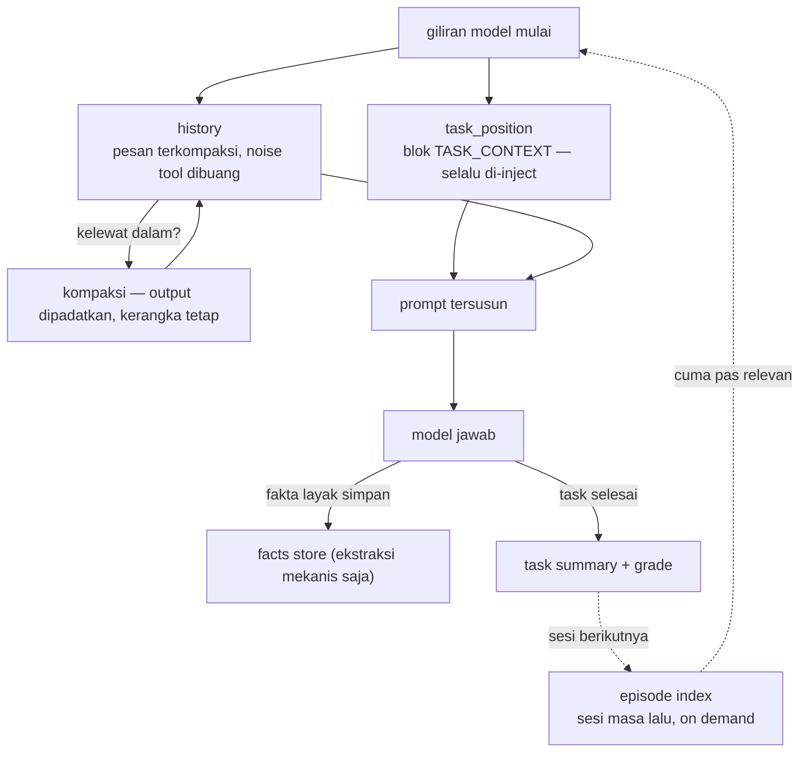

# Memori Berlapis

## Masalah awalnya

Pertanyaan pertama di balik proyek ini:

> *Gimana caranya agent nggak pernah lupa konteks — bahkan di dalam satu task room yang panjang, bahkan lintas task?*

Riwayat chat naif punya dua mode gagal: membengkak sampai model kehilangan awal percakapan di tengah, atau dipotong dan agent benar-benar lupa lagi ngapain. Dua-duanya tak bisa diterima buat agent yang jalanin sesi engineering berjam-jam.

## Solusinya: kompres, tapi jaga intinya

Memori adalah layer domain (`memory/`) berisi store-store terspesialisasi, masing-masing menyelesaikan satu jenis kelupaan:

| Store | Peran |
|---|---|
| **Fakta (Layer 1)** | Ekstraksi fakta sesi yang persisten — 100% mekanis, fakta diekstrak bukan ditulis model, plus filter stopword anti-entri khayalan |
| **History** | Riwayat pesan dengan sanitasi blok tool dan **kompaksi built-in** — output tool yang panjang dikompres, bukan maknanya |
| **Task position** | Blok `TASK_CONTEXT` yang di-inject di setiap giliran model: task apa yang aktif, lagi di step mana, keputusan apa yang sudah diambil — agent selalu tahu lagi ngapain |
| **Task summary** | Ringkasan + grade per task; riwayat satu room makin *ramping*, bukan makin bengkak, seiring kerjaannya maju |
| **Episode index** | Digest lintas-sesi yang di-format on demand — pengalaman masa lalu tersedia saat diminta, nggak di-dump default |
| **Cross-room topics** | Pointer saja — index mencatat topik apa yang dibahas percakapan lain; isinya diambil on demand dari vector store |

Gimana potongan-potongan itu menyatu di satu giliran loop:

Prinsip desainnya: **makin dalam chat, makin terkompresi — tapi intinya tetap ada.** Agent di jam keempat sesi masih punya kerangka task-nya di depan matanya di setiap giliran.

## Storage di bawahnya

Layer infrastruktur (`storage/`) memegang satu koneksi SQLite (WAL, foreign keys, busy timeout, write-lock cursor terlindungi) dengan schema versioning dan migrasi. Kode domain nggak pernah nyentuh wiring SQL mentah — satu layer pegang mekanik, satu pegang makna. Konkurensi diselesaikan dengan tetap single-writer: WAL bikin reader jalan terus padahal satu write lock lagi dipegang, dan aturan deployment-nya satu proses engine per database — instance paralel berbagi Qdrant server-mode, bukan file SQLite yang sama. Recall semantik naik vector store terpisah (Qdrant) yang bisa jalan embedded buat satu instance atau server mode buat instance paralel.

Lanjut ke: [Antarmuka](interfaces.md) — empat cara ngomong ke engine yang sama.
