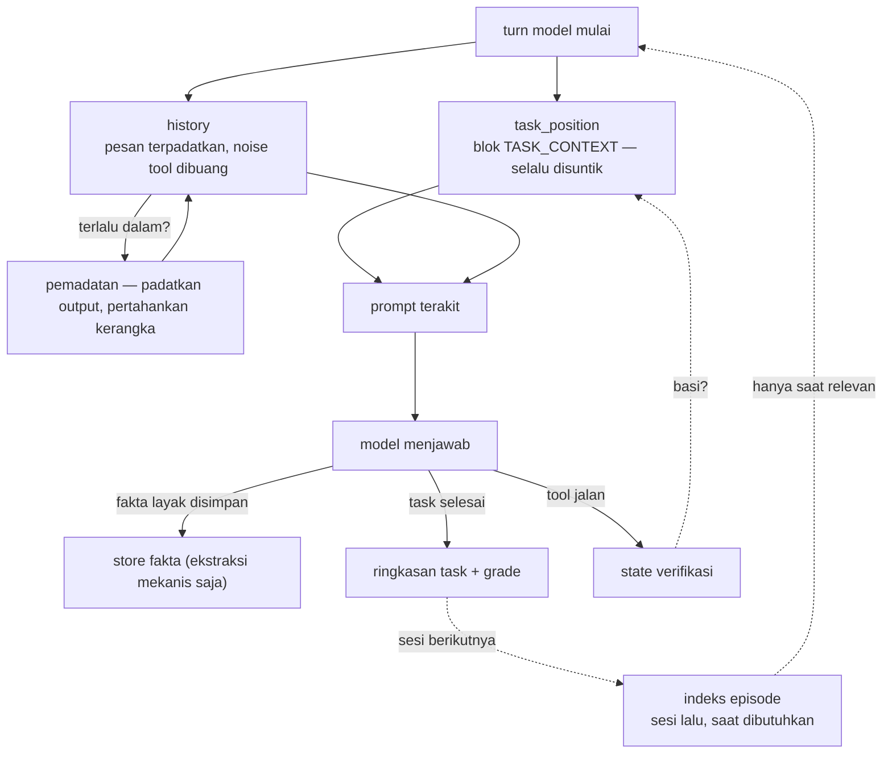

# Memory Berlapis

## Masalah asalnya

Pertanyaan paling awal di balik proyek ini:

> *"Bagaimana agent tidak pernah lupa konteks — bahkan di dalam satu room task yang panjang, bahkan antar task?"*

Chat history naif punya dua mode kegagalan: ia membengkak sampai model kehilangan bagian awal di tengah, atau ia terpotong dan agent benar-benar lupa apa yang sedang dikerjakannya. Keduanya tidak bisa diterima untuk agent yang menjalankan sesi engineering berjam-jam.

## Solusinya: padatkan, tapi pertahankan intinya

Memory adalah layer domain (`memory/`) dengan store khusus, masing-masing memecahkan satu jenis lupa:

| Store | Peran |
|---|---|
| **Fakta (Layer 1)** | Fakta sesi yang diekstrak persisten — ekstraksi mekanis saja, tidak ada fakta tulisan model, dengan filter stopword terhadap entri hasil konfabulasi |
| **History** | Riwayat pesan dengan sanitasi blok tool dan **pemadatan bawaan** — output tool panjang dipadatkan, bukan maknanya |
| **Posisi task** | Blok `TASK_CONTEXT` yang disuntik di setiap turn model: task apa yang aktif, sedang di langkah mana, apa yang sudah diputuskan — agent selalu tahu apa yang dikerjakannya |
| **Ringkasan task** | Grade dan ringkasan per task; history sebuah room tumbuh *mengecil*, bukan membesar, seiring pekerjaan berjalan |
| **State verifikasi** | Apa yang benar-benar diverifikasi di task ini, dan apakah buktinya masih segar — sebuah klaim tidak bisa diam-diam hidup lebih lama dari pengecekannya |
| **Indeks episode** | Digest lintas sesi yang diformat untuk prompt — pengalaman masa lalu tersedia saat dibutuhkan, tidak dibuang default |
| **Topik lintas room** | Pointer saja — indeks mencantumkan apa yang dibahas percakapan lain; kontennya diambil saat dibutuhkan dari vector store |

Bagaimana bagian-bagian itu memberi makan satu turn loop:

Prinsip desainnya: **makin dalam chat-nya, makin banyak yang dipadatkan — tapi intinya tetap.** Agent di jam keempat sebuah sesi masih membawa kerangka task-nya di depan mata setiap turn.

## Pemadatan terjadi saat dibaca, bukan menghancurkan

Pembedaan ini yang membuat desainnya aman: database menyimpan output tool penuh, dan `memory/history.py` menerapkan cap saat *membaca* history untuk model. Catatan yang tersimpan tidak pernah ditulis ulang jadi bentuk terpadatkan. Artinya UI masih bisa menampilkan output penuh yang benar-benar diterima agent, sementara model melihat ringkasan bergaya pointer — sesi yang sama dilihat pada dua tingkat kesetiaan, keduanya jujur.

Jendelanya sengaja dibatasi: cap keras untuk berapa turn ber-tool yang tetap utuh penuh, dan limit pesan dari `config.conversation.max_messages`. Turn yang lebih tua runtuh ke kerangkanya alih-alih hilang sama sekali.

## State verifikasi, bukan cuma memory

Kebanyakan desain memory berhenti di "apa yang dikatakan". Yang ini juga menyimpan "apa yang sudah dicek", karena agent yang mengingat kesimpulan tapi tidak mengingat buktinya akan dengan senang hati mengulang kesimpulan basi. `memory/verification.py` mengklasifikasi panggilan tool berdasarkan apakah ia benar-benar memverifikasi sesuatu, mencatat kejadiannya, dan bisa melaporkan apakah verifikasi sebuah task masih segar. Plan yang ditutup tanpa verifikasi diberi label sebagai demikian alih-alih dipresentasikan sebagai teruji.

## Ranking dan relevansi

Retrieval mengembalikan kandidat; ia tidak memutuskan apa yang benar-benar dilihat model. Layer rerank mengurutkan ulang chunk hasil retrieval berdasarkan relevansi query (sebuah layanan reranking atas kandidat, dengan jumlah kandidat/simpan yang bisa dikonfigurasi dan threshold skor yang dikalibrasi empiris untuk memutuskan antara hit yakin, hit lemah yang layak ditandai, dan miss bersih). Hit lemah diberi label lemah alih-alih dipresentasikan sebagai jawaban solid — agent tahu kapan buktinya tipis.

Layer online-learning kecil (`ml/`) menyimpan model yang punya state bisa dipelajari (baseline preferensi per sesi, pemilihan route). Sengaja sederhana: tujuannya mengurangi celah informasi — tool mana yang benar-benar dipakai, route mana yang terbukti stabil — bukan membuat agent "lebih pintar".

## Apa yang dilihat agent tiap turn

Konteks yang disuntik bukan cerita rakyat; ia bisa diperiksa. Setiap turn model menerima, antara lain: blok task-context terstruktur (task aktif, langkah sekarang, keputusan sejauh ini), history pesan terpadatkan, dan — saat dibutuhkan — digest sesi lalu plus pointer ke apa yang dibahas room lain. Karena perakitannya eksplisit, apa pun di dalamnya bisa diaudit: agent bisa mengutip blok persis yang ia terima, dan pembaca bisa memverifikasi tiap klaim terhadap apa yang benar-benar disuntikkan.

## Storage di bawahnya

Layer infrastruktur (`storage/`) memegang satu koneksi SQLite (mode WAL, foreign keys, busy timeout, cursor write-lock terjaga) dengan versioning skema dan migrasi. Kode domain tidak pernah menyentuh wiring SQL mentah — satu layer memiliki mekaniknya, satu memiliki maknanya. Konkurensi diselesaikan dengan tetap single-writer: WAL membiarkan reader jalan sementara satu write lock dipegang, dan aturan deployment-nya satu proses engine per database — instance paralel berbagi Qdrant mode server, tidak pernah file SQLite yang sama. Recall semantik menumpang vector store terpisah (Qdrant) yang bisa jalan embedded untuk satu instance atau mode server untuk instance paralel.

Lanjut: [Sub-agent](subagents.md) — apa yang terjadi saat agent butuh lebih dari satu pekerja.
