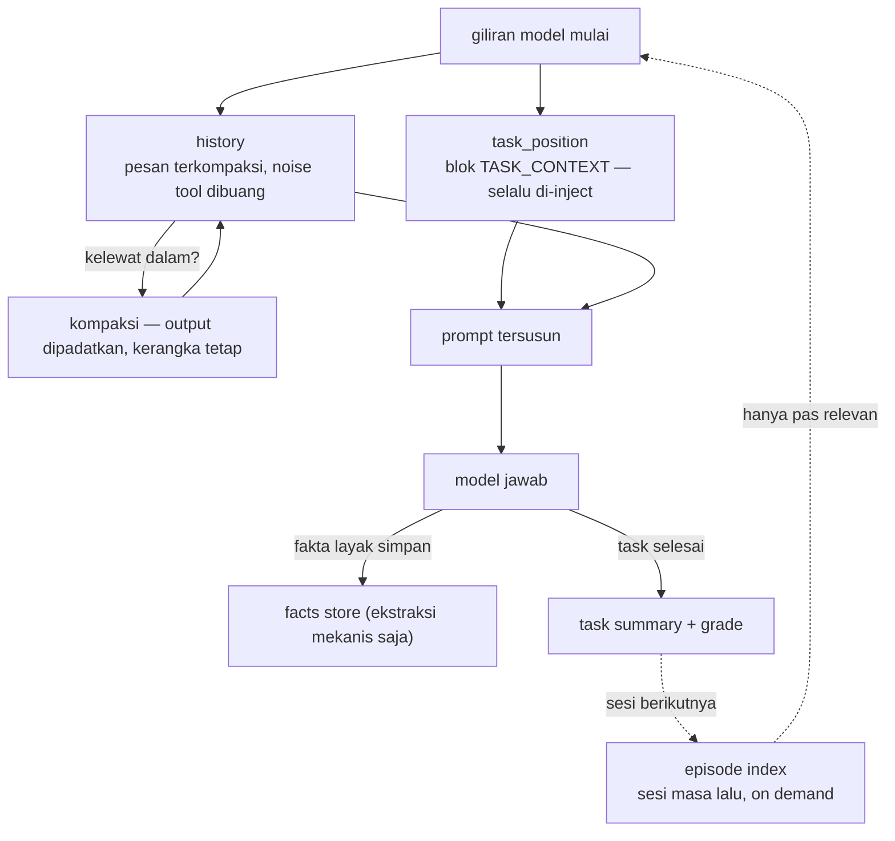

# Memori Berlapis

## Masalah awalnya

Pertanyaan pertama di balik proyek ini:

> *Bagaimana caranya agent tidak pernah lupa konteks — bahkan di dalam satu task room yang panjang, bahkan lintas task?*

Riwayat chat naif punya dua mode gagal: membengkak sampai model kehilangan awal percakapan di tengah, atau dipotong dan agent benar-benar lupa lagi ngapain. keduanya tidak dapat diterima untuk agent yang menjalankan sesi engineering berjam-jam.

## Solusinya: kompres, tapi jaga intinya

Memori adalah layer domain (`memory/`) berisi store-store terspesialisasi, masing-masing menyelesaikan satu jenis kelupaan:

| Store | Peran |
|---|---|
| **Fakta (Layer 1)** | Ekstraksi fakta sesi yang persisten — 100% mekanis, fakta diekstrak bukan ditulis model, plus filter stopword anti-entri khayalan |
| **History** | Riwayat pesan dengan sanitasi blok tool dan **kompaksi built-in** — output tool yang panjang dikompres, bukan maknanya |
| **Task position** | Blok `TASK_CONTEXT` yang di-inject di setiap giliran model: task apa yang aktif, lagi di step mana, keputusan apa yang sudah diambil — agent selalu tahu lagi ngapain |
| **Task summary** | Ringkasan + grade per task; riwayat satu room makin *ramping*, bukan makin bengkak, seiring kerjaannya maju |
| **Episode index** | Digest lintas-sesi yang di-format on demand — pengalaman masa lalu tersedia saat diminta, tidak di-dump default |
| **Cross-room topics** | Pointer saja — index mencatat topik apa yang dibahas percakapan lain; isinya diambil on demand dari vector store |

Bagaimana potongan-potongan itu menyatu di satu giliran loop:

Prinsip desainnya: **makin dalam chat, makin terkompresi — tapi intinya tetap ada.** Agent di jam keempat sesi masih memiliki kerangka task-nya di depan matanya di setiap giliran.

## Ranking dan relevansi

Retrieval menghasilkan kandidat; ia tidak memutuskan apa yang benar-benar dilihat model. Layer rerank mengurutkan ulang chunk hasil retrieval berdasarkan relevansi terhadap query (layanan reranking di atas kandidat, dengan jumlah kandidat/keep yang dapat dikonfigurasi dan threshold skor yang dikalibrasi empiris untuk memisahkan hit yakin, hit lemah yang layak diberi peringatan, dan miss bersih). Hit lemah diberi label lemah, bukan disajikan sebagai jawaban solid — agent tahu kapan buktinya tipis.

Layer online learning kecil (`ml/`) menyimpan model yang punya state belajar (baseline preferensi per sesi, pemilihan route). Sengaja dibuat modest: tujuannya mengurangi kekosongan informasi — tool apa yang benar-benar terpakai, route mana yang terbukti stabil — bukan membuat agent "lebih pintar".

## Apa yang dilihat agent tiap giliran

Konteks yang di-inject bukan hal gaib; ia bisa diperiksa. Tiap giliran model menerima, di antara lainnya: blok task-context terstruktur (task aktif, step saat ini, keputusan yang sudah diambil), riwayat pesan yang telah terkompaksi, dan — on demand — digest sesi masa lalu plus pointer ke topik yang dibahas room lain. Karena perakitannya eksplisit, semua di dalamnya bisa diaudit: agent dapat mengutip blok persis yang ia terima, dan pembaca dapat memverifikasi tiap klaim terhadap apa yang benar-benar di-inject.

## Storage di bawahnya

Layer infrastruktur (`storage/`) memegang satu koneksi SQLite (WAL, foreign keys, busy timeout, write-lock cursor terlindungi) dengan schema versioning dan migrasi. Kode domain tidak pernah menyentuh wiring SQL mentah — satu layer memegang mekanik, satu memegang makna. Konkurensi diselesaikan dengan tetap single-writer: WAL membuat reader jalan terus padahal satu write lock lagi dipegang, dan aturan deployment-nya satu proses engine per database — instance paralel berbagi Qdrant server-mode, bukan file SQLite yang sama. Recall semantik naik vector store terpisah (Qdrant) yang bisa jalan embedded buat satu instance atau server mode buat instance paralel.

Lanjut ke: [Antarmuka](interfaces.md) — empat cara ngomong ke engine yang sama.
