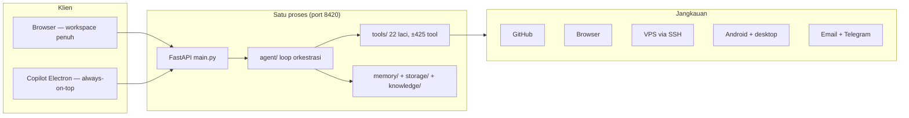

# Gambaran Sistem

## Pertanyaannya

> *Bagaimana kondisi sistem setelah berjalan delapan jam nonstop — tetap utuh, atau ujungnya tiap bagian harus diawasi manual?*

Pertanyaan itulah yang mendorong tiap keputusan di halaman ini. Skrip demo sekali jalan itu mudah; sistem yang tetap mengambil keputusan benar di jam kedelapan — dengan konteks yang telah terkompresi, belasan drawer tool terbuka, dan tiga side-quest dari awal sesi — itu masalah arsitektur.

Engrix Agent adalah AI engineering agent yang berjalan lokal, untuk satu owner: satu proses FastAPI backend, satu frontend React yang dilayani oleh proses itu sendiri, dan shell Electron opsional yang memakai frontend yang sama sebagai copilot desktop always-on-top. ia jalan di Windows — target deployment-nya adalah mesin owner — dan setiap angka di halaman-halaman ini (jumlah tool, parity registry) diambil dari checker live yang dijalankan 16-10-2026 terhadap commit `b1a7a71`.

## Kenapa foldernya dipisah-pisah

Engine adalah satu paket Python (`engrix/`) dengan layering satu arah yang ketat. Tiap folder menjawab satu pertanyaan, dan layer tinggi boleh bergantung ke layer bawah — tidak pernah sebaliknya:

```
engrix/
├── config.py        konfigurasi & path (tidak bergantung apa pun)
├── storage/         INFRASTRUKTUR: koneksi SQLite, schema, migrasi
├── memory/          DOMAIN: apa yang agent "tahu" (riwayat, fakta, task)
├── knowledge/       retrieval semantik (vector store)
├── formatting/      rendering output
├── curation/        pipeline kurasi knowledge
├── routing/         state drawer kategori & hint routing
├── personality/     persona & perakitan prompt
├── tools/           ±425 kapabilitas yang bisa dieksekusi
├── ml/              online learning & ranking
├── agent/           loop orkestrasi (planning, eksekusi, verifikasi)
├── bootstrap/       wiring: menyambungkan semuanya saat startup
├── main.py          entry point FastAPI
frontend/            UI workspace React (dilayani oleh backend)
desktop/             shell Electron (memakai build frontend yang sama)
```

Pemisahan ini bukan estetika — ia adalah kontrak perawatan:

- **`agent/` boleh memanggil `memory/`, tidak boleh `storage/` langsung.** Detail storage tidak bisa merembes ke logika orkestrasi.
- **`memory/` memegang makna domain, `storage/` memegang mekanik.** Ganti engine storage = sentuh satu layer, bukan dua puluh call site.
- **`bootstrap/` satu-satunya tempat yang tahu bagaimana potongan-potongan tersambung.** Modul lain bisa diimport dan dites terisolasi.

## Satu proses, banyak permukaan

Backend melayani build frontend-nya sendiri, jadi satu deployment = satu proses, satu port, satu versi:



Browser dapat workspace penuh; copilot Electron memuat build yang identik lewat query flag (`?ui=desktop`) — semua mode UI berbagi satu codebase dan satu dist.

## Stack

| Layer | Pilihan |
|---|---|
| Backend | Python 3.12, FastAPI, streaming chat WebSocket |
| Frontend | React + TypeScript + Vite |
| Desktop | Electron (jendela copilot frameless, always-on-top) |
| Storage | SQLite (WAL) + Qdrant (embedded lokal atau server mode) |
| Packaging | Pack portabel: source + venv + build frontend, launcher tunggal `engrix.exe` |

## Alternatif yang dipertimbangkan

- **Microservices** (backend dipecah jadi service terpisah) — ditolak: agent butuh state in-process yang dibagi (registry, state drawer, memori) dan deployment satu mesin; memecahnya hanya membeli masalah distributed-systems yang tidak dibutuhkan siapa pun di sini.
- **PostgreSQL sejak awal** — ditolak buat sekarang: satu penulis dengan SQLite embedded mode WAL sudah nutup bebannya; layer storage mengisolasi keputusan pindah engine (lihat [dual storage](../decisions/005-dual-storage.md)).
- **Memori vector-only** — ditolak: recall semantik tidak bisa mereproduksi fakta eksak; ekstraksi mekanis dan pencarian vektor menyelesaikan mode kelupaan yang berbeda, jadi keduanya tetap ada.

Lanjut ke: [Sistem Tool](tool-system.md) — bagian yang membuat agent dapat mengendalikan ratusan tools secara koheren.
