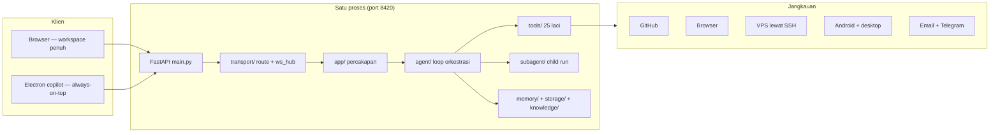

# Ikhtisar Sistem

## Pertanyaannya

> *Apa yang terjadi kalau agent seperti ini jalan delapan jam nonstop — masih utuh, atau tiap bagian akhirnya butuh ditungguin?*

Pertanyaan itu yang menggerakkan setiap keputusan di halaman ini. Skrip demo sekali jalan itu gampang; sistem yang masih mengambil keputusan benar di jam kedelapan — dengan konteks terkompresi, puluhan laci tool yang sudah terbuka, dan tiga side quest dari awal sesi — itu masalah arsitektur.

Engrix Agent adalah agent engineering local-first: satu proses backend FastAPI, satu frontend React yang dilayani proses itu, dan shell Electron opsional yang memakai ulang frontend yang sama sebagai copilot desktop always-on-top. Jalan di Windows — target deployment-nya mesin owner — dan setiap angka keras di halaman-halaman ini diukur dari source tree langsung oleh `scripts/verify_docs_claims.py`, yang gagal kalau dokumen melenceng dari kode.

## Kenapa foldernya dipisah

Engine-nya paket Python (`engrix/`) dengan layering satu arah yang ketat. Tiap folder menjawab satu pertanyaan, dan layer atas boleh bergantung ke layer bawah — tidak pernah sebaliknya:

```
engrix/
├── config.py        konfigurasi & path (tidak bergantung apa pun)
├── paths.py         tata letak filesystem, satu accessor per lokasi data
├── storage/         INFRASTRUKTUR: koneksi SQLite, skema, migrasi
├── memory/          DOMAIN: apa yang agent "tahu" (history, fakta, task)
├── knowledge.py     retrieval semantik (vector store)
├── formatting/      rendering output
├── curation/        pipeline kurasi pengetahuan
├── routing/         state laci kategori & petunjuk routing
├── personality/     persona & perakitan prompt
├── tools/           permukaan kapabilitas yang bisa dieksekusi
├── ml/              online learning & ranking
├── agent/           loop orkestrasi (planning, eksekusi, verifikasi)
├── subagent/        child run: kontrak, evidence, report, lifecycle
├── publication/     penyimpanan artefak di balik panel
├── evaluation/      capture engine — apa yang benar-benar dilihat & dilakukan agent
├── transport/       route HTTP dan hub WebSocket
├── app/             orkestrasi percakapan, approval, model request
├── bootstrap/       wiring: menyambungkan semuanya saat startup
└── main.py          entry point FastAPI (hanya perakitan app)
```

Pemisahannya bukan estetika — itu kontrak perawatan:

- **`agent/` boleh memanggil `memory/`, tidak pernah `storage/` langsung.** Detail storage tidak boleh bocor ke logika orkestrasi.
- **`memory/` memiliki domain, `storage/` memiliki mekanik.** Mengganti engine storage berarti menyentuh satu layer, bukan dua puluh call site.
- **`transport/` memiliki HTTP dan socket; `app/` memiliki arti sebuah turn.** Handler route mem-parse request lalu mendelegasikan — tidak pernah berisi logika agent.
- **`bootstrap/` satu-satunya tempat yang tahu bagaimana bagian-bagian tersambung.** Modul lain bisa diimpor dan dites terisolasi.

## Satu proses, banyak permukaan

Backend melayani frontend hasil build-nya sendiri, jadi satu deployment itu satu proses, satu port, satu versi:



Browser dapat workspace penuh; Electron copilot memuat build identik dengan flag query (`?ui=desktop`), jadi semua mode UI berbagi satu codebase dan satu dist.

## Pemisahan transport, dan kenapa itu terjadi

`main.py` dulu satu file besar yang memuat semua route. Sekarang isinya hanya perakitan app: membuat instance FastAPI, mount direktori statis, dan menyertakan satu router per domain. Route-nya sendiri tinggal di `transport/routes/`, satu modul per domain — sesi, filesystem, publikasi, realtime, subagent, recording, dan seterusnya.

Ini perlu dinyatakan terang karena inilah bedanya dokumen yang menjelaskan niat dan dokumen yang menjelaskan sistem: pemisahan ini bukan rencana di halaman ini, tapi sudah dikirim. `main.py` menyisakan satu route miliknya sendiri — catch-all yang melayani frontend — dan sisanya masuk lewat `app.include_router()`.

## Stack

| Layer | Pilihan |
|---|---|
| Backend | Python 3.12, FastAPI, streaming chat WebSocket |
| Frontend | React + TypeScript + Vite |
| Desktop | Electron (frameless, jendela copilot always-on-top) |
| Storage | SQLite (WAL) + Qdrant (embedded lokal atau mode server) |
| Packaging | Portable pack: source + venv + build frontend, satu launcher `engrix.exe` |

## Alternatif yang dipertimbangkan

- **Microservices** (backend dipecah jadi beberapa service) — ditolak: agent butuh state in-process bersama (registry, state laci, memory) dan deployment satu mesin; memecahnya cuma membeli masalah sistem terdistribusi yang tidak ada siapa-siapa di sini.
- **PostgreSQL dulu** — ditolak untuk sekarang: satu writer dengan SQLite embedded mode WAL sudah menutup bebannya; layer storage mengisolasi keputusan penggantian (lihat [dual storage](../decisions/005-dual-storage.md)).
- **Memory vector-only** — ditolak: recall semantik tidak bisa mereproduksi fakta persis; ekstraksi mekanis dan pencarian vektor memecahkan mode lupa yang berbeda, jadi keduanya tetap ada.

Lanjut: [Sistem Tool](tool-system.md) — bagian yang membuat agent mampu mengemudikan ratusan tool secara koheren.
